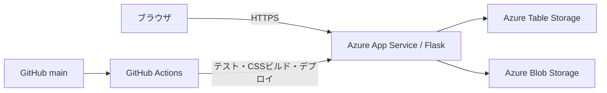

# 放課後ボード 基本設計書

- バージョン: 1.0
- 作成日: 2026-11-26
- 対応要件: [requirements.md](requirements.md)
- 開発制約: [AGENTS.md](AGENTS.md)

## 1. 設計方針

学校課題のMVPとして、FlaskとJinja2によるSSRを採用する。SPA、独立したAPIサーバー、不要な抽象化は導入しない。投稿・画像・コメントの永続化とAzureへの自動デプロイを優先する。

## 2. 技術選定

| 項目 | 技術 |
|---|---|
| Python | 3.12（Azureで利用可能なランタイムを事前確認） |
| 依存関係管理 | uv / pyproject.toml / uv.lock |
| Webフレームワーク | Flask |
| テンプレート | Jinja2 |
| CSS | Tailwind CSS v4 |
| CSSビルド | Node.js LTS / npm / @tailwindcss/cli |
| クライアント処理 | Vanilla JavaScript |
| フォーム・CSRF | Flask-WTF |
| 画像処理 | Pillow |
| Azure SDK | azure-data-tables, azure-storage-blob, azure-identity |
| Webサーバー | Gunicorn（Azure/Linux） |
| テスト | pytest |
| Lint / Format | Ruff |
| ローカルストレージ | Azurite |

Tailwindはブラウザ用Play CDNではなくCLIでビルドする。npmのロックファイルを管理し、CIでJinja2テンプレートを含むソースからCSSを生成する。クラス名は原則として静的な完全な文字列で記述する。Node.jsはCSSのビルド時のみ必要とし、本番のFlask実行環境には不要とする。

Python依存関係はuv.lockを正とし、Azureのビルド用requirements.txtはロックファイルから生成する（uv export --frozen --no-dev --no-emit-project --format requirements-txt）。手作業による二重管理を避ける。

## 3. ディレクトリ構成

```text
azure-forum/
├── AGENTS.md
├── requirements.md
├── design.md
├── README.md
├── app.py
├── forum/
│   ├── __init__.py
│   ├── routes.py
│   ├── storage.py
│   ├── forms.py
│   ├── templates/
│   │   ├── base.html
│   │   ├── index.html
│   │   ├── new_post.html
│   │   └── post_detail.html
│   └── static/
│       ├── css/
│       │   ├── input.css
│       │   └── app.css
│       └── js/
│           └── app.js
├── tests/
├── scripts/
├── .github/workflows/
├── .env.example
├── .gitignore
├── pyproject.toml
├── uv.lock
├── requirements.txt
├── package.json
└── package-lock.json
```

- app.py: Gunicorn用エントリーポイント。Application Factoryを呼び出す。
- forum/__init__.py: アプリ生成、設定、CSRF初期化。
- routes.py: HTTPリクエスト処理、画面遷移。
- storage.py: Azure SDKによるデータ取得・保存、画像のアップロード・取得。
- forms.py: フォームと入力値検証。
- templates/: 共通レイアウトと各画面。
- static/css/input.css: Tailwindの入力CSS。Jinja2テンプレート等を検出対象にする。
- static/css/app.css: ビルド済みCSS。CIで生成しデプロイ成果物に含める。
- scripts/: 必要に応じてAzure構築・検証スクリプトを置く。
- README.md: セットアップ、起動、テスト、Azure設定・デプロイ手順。

## 4. システム構成



TableとBlobは同じStorageV2アカウントを利用する。画像は非公開コンテナに保存し、Flask経由で配信する。

## 5. データ設計

### 5.1 Postsテーブル

| プロパティ | 型 | 内容 |
|---|---|---|
| PartitionKey | String | 固定値 posts |
| RowKey | String | 逆順タイムスタンプ + UUID（投稿ID） |
| nickname | String | 投稿者名 |
| title | String | タイトル |
| body | String | 本文 |
| category | String | カテゴリ識別子 |
| image_blob | String | 画像のBlob名。未添付時は空文字列 |
| created_at | DateTime | 投稿日時（UTC） |

RowKeyは、例えば固定桁の逆順Unixミリ秒とUUIDをハイフンで結合し、辞書順で新着順となるようにする。時刻部分の幅と基準値は実装で統一する。

一覧はPartitionKeyで絞り込み、カテゴリ指定時はカテゴリ条件も適用して、先頭50件で取得を打ち切る。Table Storageのページサイズ指定だけを件数制限とみなさない。

### 5.2 Commentsテーブル

| プロパティ | 型 | 内容 |
|---|---|---|
| PartitionKey | String | 対象投稿のRowKey |
| RowKey | String | 固定桁のUnixミリ秒 + UUID（コメントID） |
| nickname | String | コメント投稿者名 |
| body | String | コメント本文 |
| created_at | DateTime | 投稿日時（UTC） |

対象投稿の存在を確認してコメントを保存する。対象投稿のPartitionKeyに対するクエリでコメントを古い順に取得する。Table Storageは外部キー制約を持たないため、参照整合性はアプリケーション側で保証する。

### 5.3 カテゴリ

| 識別子 | 表示名 |
|---|---|
| study | 勉強 |
| school | 学校生活 |
| career | 進路 |
| hobby | 趣味 |
| chat | 雑談 |

定義済みの識別子のみを受け付ける。「すべて」は一覧画面用のフィルタであり、保存するカテゴリではない。

### 5.4 Blob Storage

- コンテナ名: images（非公開）
- Blob名: サーバー生成UUID + 検証済み形式の拡張子
- JPEG / PNG / WebP、1投稿1枚、元ファイル最大5 MiB。
- Pillowで実際の画像形式を確認し、デコード・再エンコードによって不要なメタデータを除去する。過大なピクセル数も拒否する。
- Content-Typeを実際の画像形式に合わせて設定する。
- Blobの保存に失敗した場合は投稿を作成しない。Blob保存後にTableへの投稿保存が失敗した場合は、当該Blobのみ可能な範囲で補償削除し、失敗時は記録する。
- 投稿との対応はimage_blobで管理する。画像の公開URLや長期有効なSASを保存しない。

## 6. ルーティング

| Method | Path | 処理 |
|---|---|---|
| GET | / | 新着投稿一覧 |
| GET | /?category=study | カテゴリ絞り込み |
| GET | /posts/new | 新規投稿フォーム |
| POST | /posts | 新規投稿 |
| GET | /posts/<post_id> | 投稿詳細・コメント一覧 |
| POST | /posts/<post_id>/comments | コメント投稿 |
| GET | /images/<blob_name> | 非公開Blobの画像配信 |
| GET | /health | アプリのヘルスチェック |

投稿とコメントの正常送信後はPost/Redirect/Getを使用する。不正入力はエラーを表示して再入力可能にし、存在しない投稿・画像は404とする。ストレージ障害時には内部情報を漏らさないエラーを表示する。

日時はUTCで保存し、表示時にJSTへ変換する。

## 7. 画面・UI設計

### 共通

- 日本語、モバイルファースト。PCでは読みやすい最大幅を設ける。
- アナログ掲示板をテーマとする。凹凸のある深緑のボードと銀色の金属枠を背景に、生成りの無地の紙の投稿を画鋲で留める。ボードのテクスチャは縦横にまっすぐ配置し、紙に罫線や繰り返し模様は入れない。陰影、金属の光沢、画鋲の立体感はCSSで表現する。
- 上下の金属枠は全画面幅で表示する。左右の金属枠はPCで表示し、640px以下のスマートフォン幅では非表示とする。
- カテゴリは投稿用紙の右上に、少し傾いた切り口のあるテープとして表示する。カテゴリごとに落ち着いたテープ色を使い、カテゴリ名も必ず表示する。
- 全体を読みやすいゴシック系のシステムフォントに統一する。本文はウェイト500、見出しは700以上、サービス名は800とする。ボード上は淡い文字、紙面上は濃い文字、ボタンは温かみのある黄土色を基調とする。
- 一覧・詳細・投稿フォーム・コメント・エラー画面でテーマを統一する。外部画像や外部フォントへの依存は追加しない。
- テキストは十分なコントラストを確保する。余白、フォーカス表示、フォームのラベル、キーボード操作を重視する。
- ヘッダーはボードと同じ背景とし、紙の形のサービス名「放課後ボード」だけを左右中央に配置する。英語の副題は表示しない。新規投稿への導線は画面右下に固定した丸い＋ボタンとし、読み上げ用のラベルとフォーカス表示を設ける。フッターにはボタンと重ならない余白を確保する。
- 過剰なアニメーション、装飾、独自コンポーネント基盤は導入しない。

### 投稿一覧

- 導入のキャッチコピー・サービス説明は表示せず、カテゴリフィルタから一覧を開始する。読み上げ用の見出し「投稿一覧」を設ける。
- 新着順の紙カードにカテゴリテープ、ニックネーム、日時、タイトル、本文のプレビューを表示する。PCでは2列、スマートフォンでは1列とし、読み順を新着順に統一する。
- 画像付き投稿の識別を可能にし、カードから詳細へ遷移する。
- 投稿がない場合は空状態と新規投稿への導線を表示する。
- コメント件数表示は必須ではなく、N+1クエリを増やさず実装できる場合のみ採用する。

### 新規投稿

- ニックネーム、タイトル、本文、カテゴリ、任意の画像添付。
- requirements.mdの入力制約を表示する。フォームにmultipart/form-dataを設定する。
- 入力エラーは項目単位で表示し、画像以外の入力値を保持する。
- 個人情報や他人の写真を無断で投稿しない旨を案内する。

### 投稿詳細

- カテゴリ、タイトル、投稿者、投稿日時、本文、添付画像を表示する。
- コメントを古い順に表示し、同画面にコメント投稿フォームを置く。
- 一覧へ戻る導線を設ける。

## 8. 設定・認証

| 環境変数 | 用途 |
|---|---|
| SECRET_KEY | Flaskセッション・CSRF保護用の秘密鍵 |
| AZURE_STORAGE_ACCOUNT_NAME | Azure Storage Account名 |
| AZURE_STORAGE_CONNECTION_STRING | Azuriteまたは承認された代替接続方式用 |

- 本番ではApp Serviceのシステム割り当てマネージドIDとAzure SDKのトークン認証を優先する。
- データアクセス権限はStorage Table Data Contributor、Storage Blob Data Contributor等の必要最小限とする。
- ローカルはAzuriteへの接続文字列を利用し、テストは必要に応じてストレージ層をモックする。
- .env.exampleには変数名と安全な例のみを記載する。実際の.env、秘密鍵、認証情報はGit管理対象外とする。
- 本番のSECRET_KEYは安全に生成し、再起動で変化しないようApp Serviceの設定に保存する。
- 本番はHTTPS Only、Secure/HttpOnly/SameSite=LaxのセッションCookieを使用する。Jinja2の自動エスケープを維持し、ユーザー投稿をsafe扱いしない。
- 画像サイズ制限に加え、multipartのオーバーヘッドを考慮したHTTPリクエスト上限を設定する。

## 9. Azureリソース構成

| リソース | 方針 |
|---|---|
| サブスクリプション | Azure for Students |
| リソースグループ | プロジェクト専用 |
| リージョン | Japan East優先、実際のポリシーとSKU可用性を確認 |
| App Service Plan | Linux / F1優先 |
| Web App | Python 3.12優先、Gunicornでapp:appを起動 |
| Storage Account | Standard / LRS / StorageV2 |
| Tables | Posts, Comments |
| Blob Container | images（非公開） |

命名はafterschool-boardを基準とし、Storage Accountの命名制約やグローバル一意性に従って調整する。リージョン、SKU、実際のリソース名は構築時に決定する。有料SKUや想定外の課金、権限不足に関してはAGENTS.mdに従う。

## 10. CI/CD

- PRに対してRuff、pytest、Tailwind CSSビルドを実行する。
- mainへのpushで同じ検証を実行し、成功後のみAzure App Serviceに自動デプロイする。
- npm ciとTailwind CLIによる本番用CSS生成を行い、成果物に含める。
- uv.lockに基づいてPython依存関係を固定し、AzureのPythonビルド用requirements.txtを生成する。
- AzureのPython依存関係インストール方式を一つ選び、デプロイ成果物と整合させる。App Serviceのリモートビルドを利用する場合は必要なビルド設定を有効にする。
- OIDCを優先する。GitHub Actionsのデプロイ権限は対象リソースに限定し、認証情報をコミットしない。
- デプロイ後はWeb Appを明示的に再起動し、新しいOryxビルドを読み込ませる。成果物の`forum/static/release.json`にコミットIDとCSSのSHA-256を含め、配信中のリリース情報・CSSが成果物と一致すること、/healthと一覧が正常であることを確認する。旧版がHTTP 200を返すだけでは成功としない。

## 11. テスト・実装順序

pytestではフォーム入力検証、カテゴリ、投稿・コメントの関連付け、画像検証、主要ルート、エラー応答を優先する。クラウド認証情報に依存しないCIとし、Azuriteまたはモックを利用する。Azure実環境ではrequirements.mdの受入条件に従い、実データの永続化、画像配信、自動デプロイを確認する。

1. Azureのサブスクリプション・リージョン・SKU・権限を確認。
2. 最小限のFlaskアプリ、CI/CD、Azureのデプロイ経路を確立。
3. 投稿一覧・投稿作成・詳細画面とTable Storage接続。
4. Blob Storageによる画像投稿・配信。
5. コメント機能、TailwindによるUI整備、セキュリティ対策。
6. 受入テスト、README更新、デプロイ確認。

課題の実証環境として利用し、通報・管理機能等が未整備のまま不特定多数の高校生を募集することはしない。
